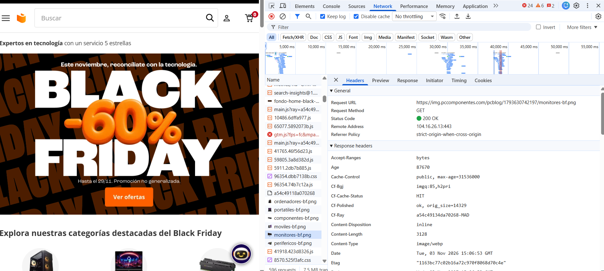
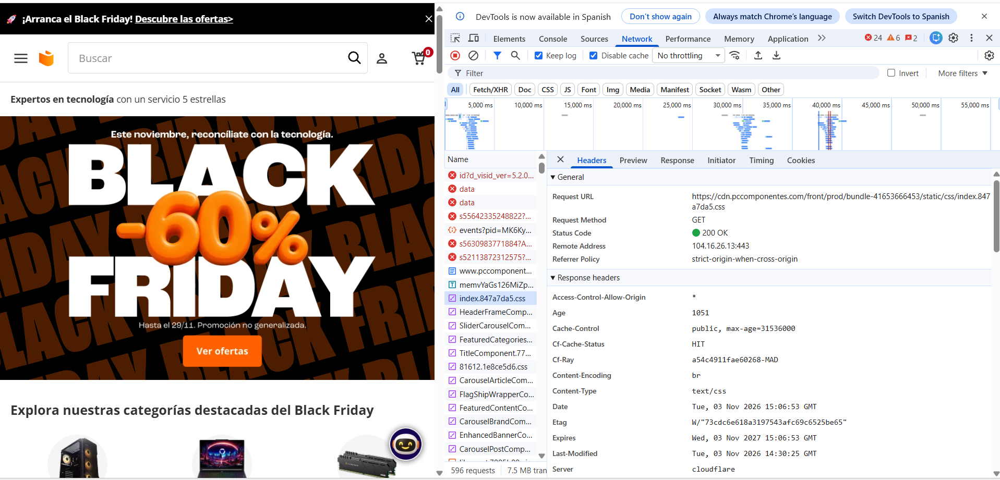
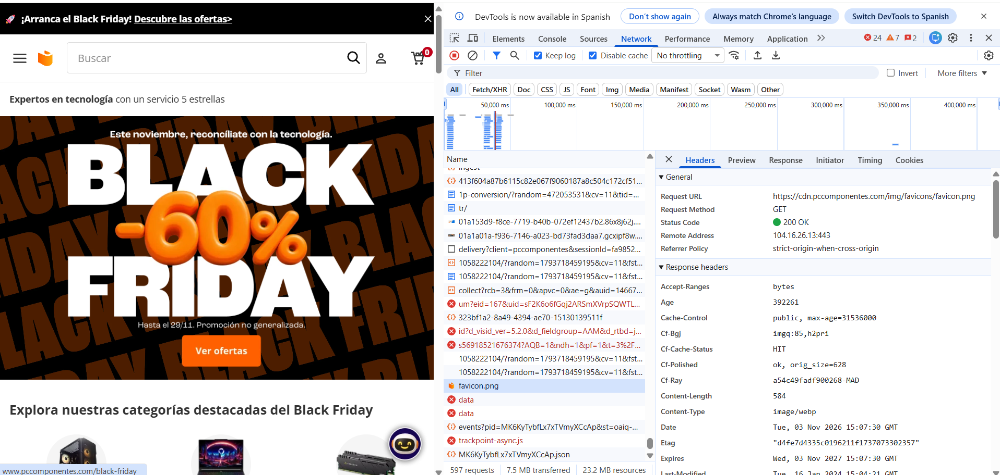
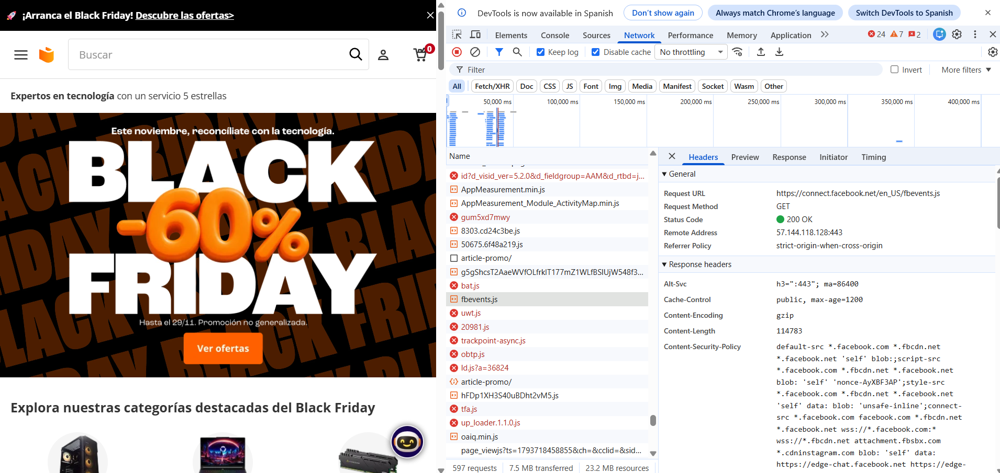

# ficha-8---Mini-proyecto-UT1

Pagina: PCComponentes
Url: https://www.pccomponentes.com/

Identificar el Frontend del Backend

Frontend

El frontend es la parte de PcComponentes que se ejecuta en el navegador y con la que interactúa el usuario.

Podemos identificar:
- La página principal.
- El menú de categorías.
- El buscador de productos.
- Las fichas de productos.
- Las imágenes, los precios y los botones.
- El carrito de compra.
- Los estilos y elementos visuales.
Tecnologías que forman habitualmente parte del frontend:
- HTML: estructura de la página.
- CSS: estilos visuales.
- JavaScript: interactividad y comportamiento.

Backend
El backend es la parte que funciona en los servidores de PcComponentes.

En una tienda online como PcComponentes, el backend se encarga de funciones como:
- Gestionar el catálogo de productos.
- Obtener información de productos y precios.
- Procesar búsquedas.
- Gestionar el carrito y las cuentas de usuario.
- Tramitar pedidos.
- Consultar información relacionada con disponibilidad y stock.

Tecnologías que forman habitualmente parte del backend:
- Javascript
- Java
- Python
- C#

Como funciona el modelo cliente-servidor en pccomponentes.

Cuando un usuario busca una tarjeta gráfica:
1. Escribe el nombre en el buscador.
2. El navegador realiza una petición al servidor.
3. El servidor procesa la búsqueda.
4. Devuelve información de los productos que coinciden.
5. El navegador muestra los resultados.

El modelo cliente-servidor permite que el navegador solicite información y que el servidor la procese y responda.

Es un get, da un codigo 200 por lo que esta bien la peticion y el content-type es image/webp por que es una imagen en ese formato.

Es un get, da un codigo 200 por lo que esta bien la peticion y el content-type es text/css por que es un archivo css para darle formato al index.

Es un get, da un codigo 200 por lo que esta bien la peticion y el content-type es image/webp por que es una imagen en ese formato, es para el fabicon.

Es un get, da un codigo 200 por lo que esta bien la peticion y el content-type es application/x-javascript; charset=utf-8;